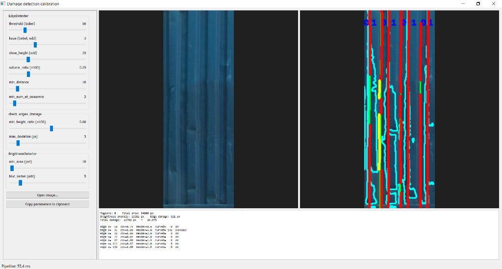
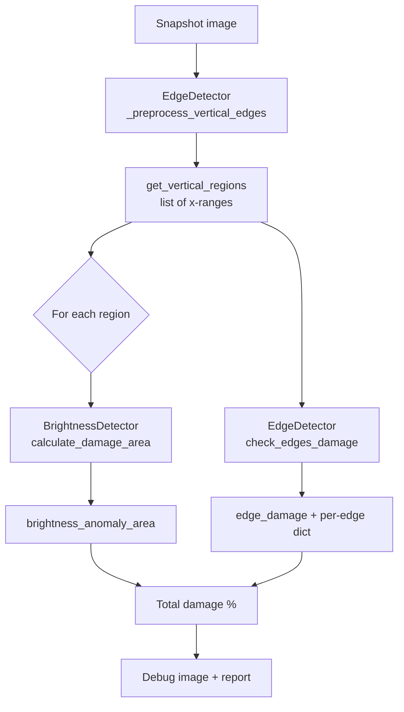

# Container Damage Detector

A computer-vision pipeline that analyses **snapshot images of shipping-container corrugated walls** and reports two independent classes of damage:

| Class | Signal |
|---|---|
| **Brightness anomaly** | Holes, tears, or punctures — detected as regions that are significantly darker than the surrounding wall |
| **Edge damage** | Bent, curved, or missing vertical corrugation edges — detected via Sobel edge maps and polyline fitting |

---

## Project structure

```
Container-Damage-Detector/
├── core/
│   ├── edge_detector.py        # EdgeDetector — Sobel + morphological closing + line fitting
│   └── brightness_calc.py      # BrightnessDetector — dual-Otsu hole/tear segmentation
├── main.py                     # CLI entry-point: runs the full pipeline on one snapshot
├── calib_gui.py                # Interactive PyQt5 calibration GUI
├── test_data/                  # Sample snapshot images
├── debug/                      # Pipeline debug images written by main.py
├── docs/                       # Diagrams and task spec
├── experiments/                # Scratch / tuning scripts
└── requirements.txt
```

---

## How it works

### 1 — Vertical region detection (`EdgeDetector`)

```
Grayscale → Sobel-X → threshold → morphological CLOSE (vertical kernel)
→ column scoring → group columns → filter noise → edge centres
→ split image into corrugation regions
```

Key parameters:

| Parameter | Default | Meaning |
|---|---|---|
| `threshold` | 50 | Sobel response binarisation threshold |
| `ksize` | 3 | Sobel kernel size (odd) |
| `close_height` | 25 | Height of the 1-px-wide vertical closing kernel — bridges illumination gaps inside each edge column |
| `column_ratio` | 0.25 | Minimum fraction of image height a column must be filled to be counted as an edge |
| `min_distance` | 10 | Minimum pixel gap between two distinct edges |
| `min_num_of_coloumns` | 2 | Minimum group width to keep (removes single-column noise) |

### 2 — Hole / tear detection (`BrightnessDetector`)

Each corrugation region is processed independently:

```
GaussianBlur → first Otsu split (dark vs bright)
  ├─ bright majority  → bimodal image: dark region = hole  (single Otsu)
  └─ dark majority    → trimodal image (hole + wall + text)
                           → second Otsu on dark half only
                           → separates hole from wall
→ findContours → filter by area + brightness → measure anomaly area
```

Key parameters:

| Parameter | Default | Meaning |
|---|---|---|
| `min_area` | 10 | Minimum contour area (px²) to accept |
| `blur_kernel` | (5, 5) | Gaussian blur kernel size before thresholding |

### 3 — Edge damage assessment (`check_edges_damage`)

For each detected vertical edge:

```
Row-average x-positions → polyfit straight line + vertical reference
→ per-row deviation = max(residual from fit, drift from top anchor)
→ coverage  = fraction of image height the edge spans
→ is_continuous  if coverage  ≥ min_height_ratio
→ is_straight    if max(deviation) ≤ max_deviation
```

Key parameters:

| Parameter | Default | Meaning |
|---|---|---|
| `min_height_ratio` | 0.60 | Minimum vertical coverage fraction for a continuous edge |
| `max_deviation` | 3 | Maximum allowed per-row deviation (px) from a straight line |

### 4 — Debug visualisation colour key

| Colour | Meaning |
|---|---|
| 🟢 Green line | Continuous straight edge |
| 🟣 Magenta line | Incomplete edge (coverage < threshold) |
| 🔴 Red dot | Straight edge pixel (normal) |
| 🟡 Yellow dot | Curved / deviated edge pixel |
| 🩵 Cyan contour | Detected hole or tear (brightness anomaly) |
| 🔵 Blue `0` / `1` | Corrugation trough / crest classification |

---

## Quickstart

### Requirements

```bash
pip install -r requirements.txt
pip install PyQt5          # only needed for the calibration GUI
```

### Run the pipeline

```bash
python main.py
```

Edit the `image` path at the top of `main.py` to point at your snapshot. The script prints a damage report and writes `debug/debug_image.png`.

**Example outputs:**

| Image | Damage % | Notes |
|---|---|---|
| `cropped_container2_1.jpg` | ~0 % | Normal corrugated wall — no anomalies |
| `cropped_container3_1.jpg` | ~27 % | Large tear / hole |
| `cropped_container4_1.jpg` | ~34 % | Severely crushed / bent panels |

---

## Calibration GUI

```bash
python calib_gui.py                          # opens default image
python calib_gui.py test_data/my_crop.jpg   # open a specific snapshot
```

Slider values are initialised directly from each class's constructor defaults and the `check_edges_damage` method signature — changing a default in the code is immediately reflected in the GUI the next time it starts.



**Controls:**

| Control | Action |
|---|---|
| Any slider | Re-runs the full pipeline automatically (120 ms debounce) |
| **Open image…** | Load a different snapshot at runtime |
| **Copy parameters to clipboard** | Copies a ready-to-paste Python code block with all current values |

The stats panel below the debug image mirrors the same numbers printed by `main.py`:
- Region count and total area
- Brightness anomaly area (px) from `BrightnessDetector`
- Edge damage (rows) from `EdgeDetector`
- Total damage percentage
- Per-edge breakdown: coverage, max deviation, curved-row count, DAMAGED / ok

---

## Output format

`main.py` prints:

```
========== SNAPSHOT RESULTS ==========
Number of regions:         8
Total snapshot area:   54880 pixels
Brightness anomaly area: 13381 pixels
Edge damage:              321 pixels
Total damaged area:     13702 pixels
Damage percentage:        24.97%

Edge details:
{'edge_center': 31, 'coverage': 1.0, 'max_deviation': 5.0,
 'curved_pixels': 148, 'is_continuous': True,
 'is_straight': False, 'is_damaged': True}
...
```

---

## Architecture



---

## Tuning tips

> [!TIP]
> Use `calib_gui.py` to tune all parameters live. When satisfied, click **Copy parameters to clipboard** and paste the block into `main.py`.

> [!NOTE]
> `column_ratio` and `close_height` are the two most image-dependent parameters. Lower `column_ratio` to detect edges in lower-contrast or unevenly lit images; increase `close_height` if vertical gaps inside edge columns cause missed edges.

> [!WARNING]
> `max_deviation` uses per-row average x-positions — it is in **pixels**, not percentage. At `3 px` it is strict; on wide-angle or distorted shots you may need to raise it to `5–8 px`.
